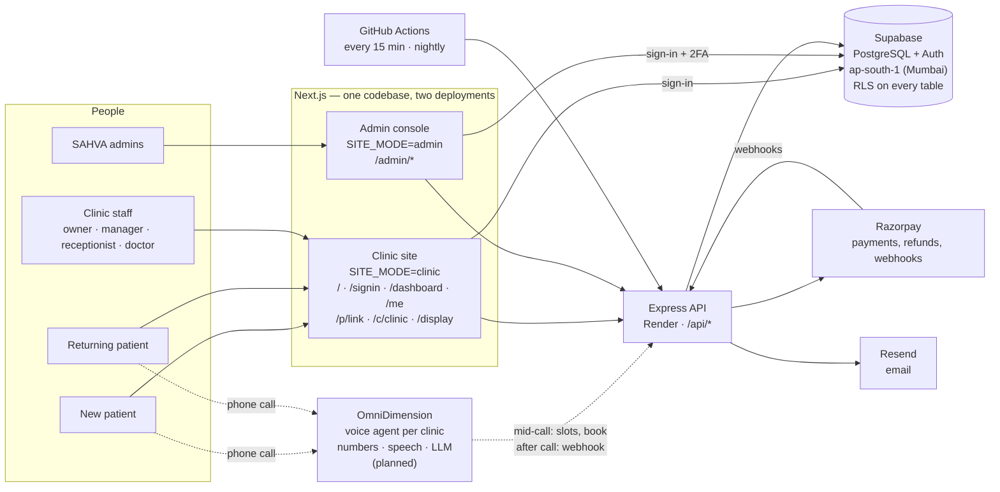
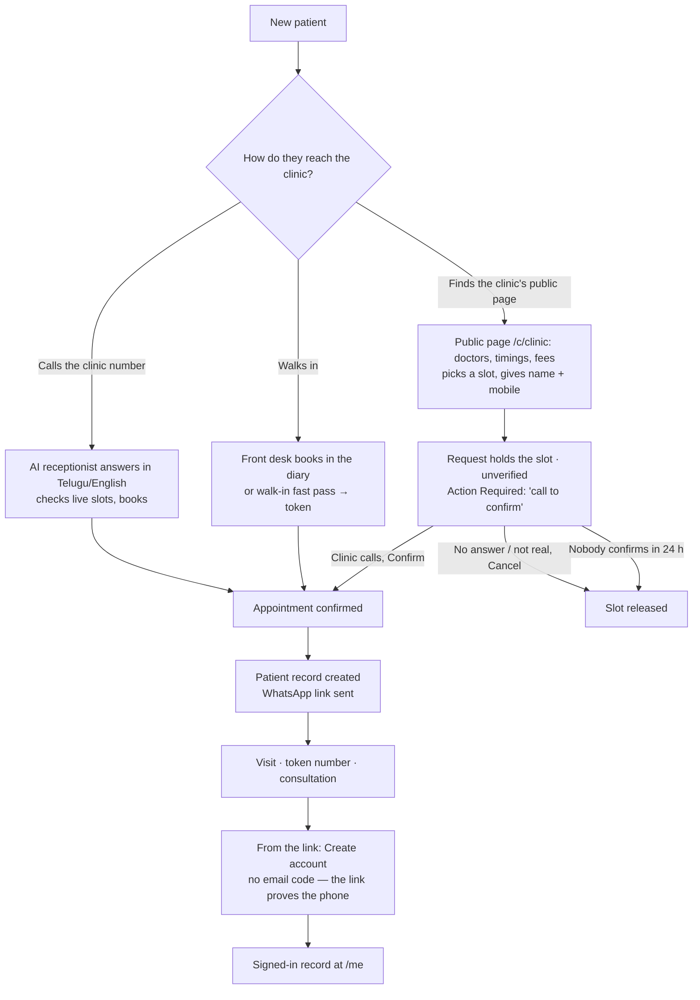
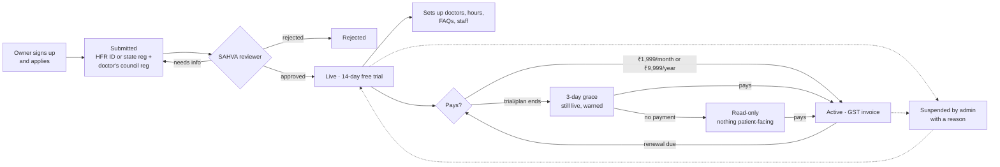
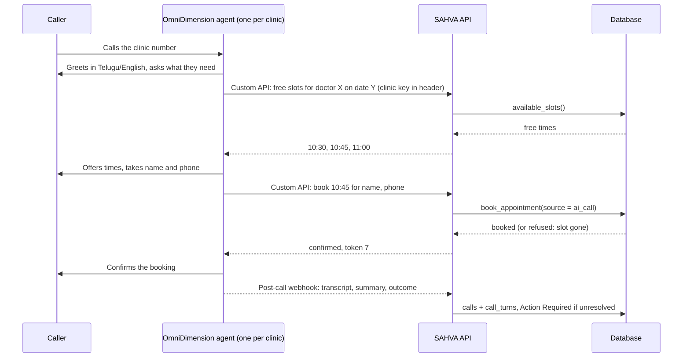

# SAHVA

**Telugu-and-English AI receptionist for solo and small clinics in Tier 2/3 towns.**
It answers every call (voice agents run on [OmniDimension](https://omnidim.io)),
books real appointments off live availability, lets
patients see their record and book online, and never lets a schedule change
silently cancel a patient without staff knowing.

> **Branch: `saikirans-version`** — maintained by Saikiran.
> A multi-tenant Supabase schema, an Express API with real authentication, a
> clinic dashboard, a patient record and portal, a public booking page per
> clinic, subscriptions through Razorpay, and a separate admin console for the
> people who run SAHVA.

---

## Contents

- [Try it in thirty seconds](#try-it-in-thirty-seconds)
- [How SAHVA works](#how-sahva-works) — architecture, who uses it
- [Patient journeys](#patient-journeys) — new patient, returning patient
- [Clinic journey](#clinic-journey) — apply, approval, trial, paying
- [What each dashboard contains](#what-each-dashboard-contains) — patient, clinic, admin
- [Voice calls — OmniDimension](#voice-calls--omnidimension) — the MVP voice plan, costs, demo
- [Behind the scenes](#behind-the-scenes) — emails, scheduled jobs, money, privacy
- [Resilience — no single point of failure](#resilience--no-single-point-of-failure) — what is fixed, what needs a decision
- [Repository layout](#repository-layout) · [Migrations](#migrations) · [Design decisions](#three-design-decisions-worth-knowing)
- [Running the tests](#running-the-tests) · [Running it on localhost](#running-it-on-localhost) · [Deploying](#deploying)
- [Status and next steps](#status-and-next-steps)

---

## Try it in thirty seconds

No Supabase project, no API process, no keys:

```bash
npm install
NEXT_PUBLIC_MOCK=1 npm run dev -w apps/web
```

Open <http://localhost:3000>. Sign-in is bypassed and every screen is served
from fixtures in `apps/web/lib/mock/` — Sri Sai Clinic, its doctors, patients,
the Action Required queue, the patient record (`/me`), the public page
(`/c/sri-sai-warangal`) and the admin console (`/admin`). Writes change the
fixtures in memory until you reload.

Mock mode is a review and demo aid, not a test double — the database tests run
against real PostgreSQL. `NEXT_PUBLIC_MOCK` must never be set in a deployed
environment; with it unset the bundler drops the fixtures entirely.

---

## How SAHVA works

### Architecture



- **One database is the authority.** Availability, double-booking, who may see
  what, clinic verification, the trial and grace rules, money and audit trails
  are enforced in PostgreSQL (functions, constraints, triggers, row-level
  security) — not in the browser and not in the AI.
- **The browser never holds a secret.** Pages call the API with the user's own
  session; the API uses the service key only server-side, after its own checks.
- **Voice runs on OmniDimension, bookings run on SAHVA.** OmniDimension
  answers the phone, understands Telugu and English and speaks back; whenever
  the caller wants a time it asks SAHVA's API, so the clinic's live diary — not
  the voice agent — decides what is free and what gets booked.
- **The clinic site and the admin console are the same app deployed twice**
  (`SITE_MODE`): `/admin` does not exist on the clinic site, and the console
  serves nothing else. Admin sign-in always needs an authenticator code.

### Who uses it

| | Who | Where | How they sign in |
|---|---|---|---|
| **New patient** | Has never visited the clinic | Phone call, walk-in, or the clinic's public page `/c/<clinic>` | No account needed |
| **Returning patient** | Has a record at the clinic | The WhatsApp link `/p/<link>`, or their record at `/me` | The link itself, or email + password (account created from the link) |
| **Clinic staff** | Owner, manager, receptionist, doctor | `/dashboard` | Email + password; owners apply, staff are invited |
| **SAHVA admin** | The people who run SAHVA | Admin console `/admin` (own domain) | Email + password + authenticator code, every time |

---

## Patient journeys

### A new patient

There are three ways in. Each one ends with the patient's record in the
clinic's diary and a WhatsApp link in their hand.



1. **Phone.** The clinic's OmniDimension agent answers, asks SAHVA's API for
   free slots against the live diary, and books through SAHVA. The database re-checks the slot inside the transaction,
   so a slot the AI "thought" was free cannot be double-booked.
2. **Walk-in.** The front desk books them, or uses the walk-in fast pass (name +
   phone → next token number).
3. **Public page `/c/<clinic>`** — for someone who found the clinic online. They
   see the doctors, specialities, timings and fees, pick a free slot and give
   their name and mobile number. Until SMS one-time codes are set up, the number
   is not proven, so the request **holds the slot as unverified** and the clinic
   gets an urgent **"Online request — call to confirm"** item. Confirming makes it
   a normal appointment; unconfirmed requests are released after 24 hours (or 1
   hour before the slot). Limits: 2 hours to 14 days ahead, one open request per
   number, 20 unconfirmed per clinic per day, 5 per connection per hour.

After the first booking the patient has a record at that clinic and a **link**
(`/p/<link>`) for their appointment. From the link they can **create an
account** — no email verification, because holding the link already proves the
phone the clinic has on file.

### A returning patient

| Through the WhatsApp link `/p/<link>` (no sign-in) | Signed in at `/me` |
|---|---|
| See their appointment: doctor, time, token number and how many patients are ahead | Everything on the left, plus the full record |
| Confirm it | Book a new appointment with any of the clinic's doctors |
| Reschedule to a free slot with the same doctor (if the clinic allows) | Visits, medicines, vaccines, bills, care tasks |
| Cancel (if the clinic allows, within its window) | Switch between clinics, if registered at more than one |
| Clinic hours, call, directions; share the time with family on WhatsApp | Print a prescription |
| Create an account | |

A patient who already has an account simply signs in at `/signin`. Sign-in
always lands people where their account belongs — staff on the dashboard,
patients on `/me` — whichever tab they clicked.

---

## Clinic journey



- **Apply.** The owner signs up at `/signin` (Clinic staff → create account),
  then submits the clinic: name, address, phone, **HFR ID or state
  clinical-establishment registration**, the owner doctor's **medical council
  registration**, optional GSTIN, and documents.
- **While under review** the clinic can set up doctors, hours, FAQs and staff,
  but **nothing patient-facing runs**: no AI bookings, no WhatsApp or online
  bookings, no patient links, no public page.
- **Approval** starts a **14-day free trial**. Plans are prepaid through
  Razorpay — **₹1,999/month or ₹9,999/year, GST included where it applies** — and
  never renew on their own.
- **Lapse.** When a trial or paid period ends there are **3 days of grace**
  (everything works, reminders go out), then the clinic becomes **read-only**:
  its data stays visible, nothing patient-facing runs, until it pays.
- Every payment gets a **GST invoice**, every refund a **credit note**.

---

## What each dashboard contains

### Patient — WhatsApp portal `/p/<link>`

No sign-in; the link is the key. Hashed, expiring, scoped to scheduling only —
it never reaches medical records. In the patient's language (Telugu or English).

- Upcoming appointment: doctor, time, **token number, patients ahead**
- **Confirm**, **reschedule** (free slots for the same doctor), **cancel** — each
  only if the clinic allows it
- Clinic hours, call, directions; "tell family on WhatsApp" (without the link)
- **Create account** → the signed-in record

### Patient — signed-in record `/me`

| Area | What the patient sees and can do |
|---|---|
| Header | Their name, clinic, Telugu/English switch, sign out; clinic switcher if registered at several SAHVA clinics |
| Next appointment | Date, time, doctor and speciality, status, fee; call the clinic, directions |
| Quick actions | Call · **Book** · Medicines · Records |
| Summary tiles | Medicines being taken, amount owed, ongoing conditions |
| Care tasks | Follow-ups and reminders the clinic set |
| **Your clinic** | Every doctor — speciality, qualifications, weekly timings, languages, fee — with **Book**: pick a day the doctor sits, then a free slot (books straight into the diary; at most 2 open online bookings); clinic hours and closures; services and prices; common questions |
| Visits | Past consultations, doctor and speciality |
| Medicines | Prescriptions with a dosage chart; printable prescription (`/me/rx/<id>`) |
| Vaccines | Given and due |
| Bills | The clinic's invoices to the patient |
| Sidebar | Current conditions, clinic card, "your record is private" |

Every time a patient's medical record or profile is opened — by the patient,
by staff, or by SAHVA support — it is written to an access log the clinic owner
can see.

### Clinic — staff dashboard `/dashboard`

| Page | What it is | Owner | Manager | Receptionist / Doctor |
|---|---|:-:|:-:|:-:|
| **Overview** | Today: appointments with tokens, live updates, what needs attention | ✓ | ✓ | ✓ |
| **Action Required** | Everything that needs a person: reschedules after a doctor's leave (review → call → rebook), **online requests to call back**, AI escalations, low-confidence calls, failed messages, refused bookings, dropped calls | ✓ | ✓ | ✓ |
| **Appointments** | The diary: day view per doctor, book, walk-in fast pass, confirm, check in, complete, no-show, reschedule, cancel; unverified online requests are marked | ✓ | ✓ | ✓ |
| **Calls** | Every AI call: outcome, language, summary, transcript, what the AI tried and what the database refused | ✓ | ✓ | ✓ (transcripts can be hidden from receptionists) |
| **Patients** | Search, profile, appointments, medical record, issue a portal link; who opened this record (access log) | ✓ | ✓ | ✓ (access log: owner & manager) |
| **Analytics** | Calls, bookings, AI share, no-shows, recovered missed calls | ✓ | ✓ | ✓ |
| **Settings → AI permissions** | What the AI may do (book, reschedule, cancel), notice, horizon, reminders, escalation number; **Online booking**: the public page link and its switches | ✓ | ✓ | — |
| **Settings → Doctors & schedule** | Doctors, specialities, fees, weekly sessions, leave | ✓ | ✓ | — |
| **Settings → Hours & closures** | Clinic hours, holidays | ✓ | ✓ | — |
| **Settings → Knowledge base** | FAQs and services the AI and the public page use | ✓ | ✓ | — |
| **Settings → Staff** | Invite staff, change roles, suspend | ✓ | ✓ | — |
| **Settings → Billing** | Trial/plan status, pay monthly or yearly, payment history, **GST invoices and credit notes** | ✓ | ✓ | — |
| **Settings → Privacy & support** | Transcript retention (30–365 days) and receptionist visibility; **open support access** for SAHVA for 1–72 hours | ✓ (changes) | view | — |
| **Verification** | The application's status, the reviewer's notes, edit and resubmit | ✓ | — | — |
| **Waiting-room screen** `/display` | Full-screen token board for a TV | ✓ | ✓ | ✓ |

Banners at the top tell the clinic when it is under review, on trial, in grace,
or read-only.

### SAHVA admin console `/admin` (separate deployment)

Sign-in: password **and** authenticator code, every time; every action is
written to an append-only audit log. Admin accounts can never belong to a
clinic, and patients are never visible except through access the clinic grants.

| Page | What it is | Who |
|---|---|---|
| **Overview** | Clinics, MRR and ARR from the payment ledger, paying clinics, trials ending, payments this month; links to applications waiting, payment problems and refunds awaiting approval | all |
| **Applications** | The review queue: IDs, council registration, documents, possible duplicates; start review, approve (starts the trial), ask for information, reject — reasons required | reviewer |
| **Clinics** | Every clinic's stage (review, trial, paying, grace, read-only, suspended) with an attention filter; per clinic: usage counts (never patient names), payments and invoices, staff, notes, history, **emails sent to the owner**, extend a trial or paid period with a reason, **support access** when the clinic has granted it | all; extend: finance; support access: support |
| **Payments → Ledger** | Every order and payment; refund (policy suggested; above ₹2,000 needs a second admin); invoice links | finance |
| **Payments → Refund approvals** | Large refunds waiting for a *different* finance admin to approve (refunds through Razorpay) or decline | finance |
| **Payments → Exceptions** | Paid-not-activated, duplicates, wrong amounts, held payments, failed refunds, disputes — with the fix for each | finance |
| **Payments → Webhook events** | Every Razorpay webhook, verified or not; check unfinished orders with Razorpay | finance |
| **Analytics** | MRR by month, bookings across clinics, a month-by-month table, **clinic health** scores with reasons | all |
| **Security** | Failed sign-ins, denied requests, invalid patient links, rate limiting, staff role changes; most-refused addresses | all |
| **Audit log** | Every admin action, who, when and why | all |
| **Settings** | SAHVA's business details for invoices (legal name, address, GSTIN, PAN, SAC, GST rate) and the refund approval limit | super admin edits |

Admin roles: **super admin** (everything), **reviewer** (applications),
**finance** (money), **support** (notes, clinic-granted access), **analyst**
(read-only analytics).

### Public pages

| Page | |
|---|---|
| `/` | Landing page: product, Telugu, pricing, FAQ |
| `/c/<clinic>` | The clinic's public page and booking requests |
| `/signin`, `/forgot-password` | One door for patients and staff |
| `/terms`, `/privacy`, `/refund-policy`, `/contact` | Required by Razorpay before live payments |

---

## Voice calls — OmniDimension

> **Status: planned, not built yet.** The decision (Oct 2026) is to use
> [OmniDimension](https://omnidim.io) for the phone side of the MVP instead
> of assembling telephony, speech-to-text, text-to-speech and the language
> model ourselves. The `apps/api/src/claude/` voice route stays as the
> fallback and the reference for the tools.

### What OmniDimension does and what SAHVA does

| OmniDimension (voice) | SAHVA (everything the call touches) |
|---|---|
| Phone numbers: a +91 number bought in OmniDimension (eKYC once), or the clinic's own number imported (Exotel, Twilio, SIP) | Which clinic a number belongs to |
| Speech in and out in **Telugu and English** (listed for both understanding and speaking), the conversation, the voice | The clinic's doctors, timings, fees, FAQs — the agent's script is generated from SAHVA's data |
| Calls SAHVA's API **mid-call** ("Custom API") when the caller asks for a time | Live availability, booking through `book_appointment()` — no double booking, the live-clinic guard |
| Sends the result **after the call** (post-call webhook: transcript, summary, extracted details) | Stores the call, transcript and outcome; raises Action Required for anything unresolved |
| Website voice widget (for the demo) | The landing page it sits on |

### How a call flows



### What has to be built

1. **Agent per clinic.** Create and update an OmniDimension agent through its
   API when a clinic is approved, and whenever doctors, hours or FAQs change —
   the script comes from the same clinic profile the public page uses.
2. **Mid-call endpoints** under `/api/voice/omnidim/*`: free slots, book,
   find the caller's existing appointment, cancel/reschedule (only as the
   clinic's AI permissions allow). Each request carries a per-clinic secret
   header, so a request is tied to exactly one clinic.
3. **Post-call webhook** `/api/webhooks/omnidim`: verified, stored once,
   written to `calls`, `call_turns` and `call_summaries`; escalations, failed
   bookings and dropped calls go to Action Required — exactly what the
   dashboard's Calls page already shows.
4. **Number mapping**: each clinic's number → its agent, kept in SAHVA.
5. **Demo**: SAHVA's own demo agent and number on the landing page, plus
   OmniDimension's website voice widget, running on the free credits — fixed
   to a demo clinic so it can never book into a real diary.

### If OmniDimension or SAHVA is down

A clinic's phone must never just ring out. The design keeps a person in the
path:

1. **Keep the clinic's own number at its carrier** (Exotel or the clinic's
   provider) and forward to the OmniDimension agent with **failover to the
   front-desk phone** — on no answer, busy or error the call rings the clinic
   as it did before SAHVA.
2. **If SAHVA's API does not answer mid-call** (timeout or error), the agent
   does not guess a time: it takes the caller's name and number, says the
   clinic will call back, and the post-call webhook raises a "call back"
   item in Action Required. Nothing is booked that the database did not
   confirm.
3. **If the post-call webhook is lost**, SAHVA fetches the call log from
   OmniDimension's API on the next scheduled pass, so no call disappears.
4. The **escalation number** in Settings → AI permissions is the transfer
   target for anything the agent should not handle.

**To check with OmniDimension before building:** whether the caller's number
reaches the Custom API automatically (their docs say not to assume it), how
mid-call requests time out, how post-call webhooks are signed, concurrent
calls per plan, the monthly rent for a +91 number, and how well Telugu–English
code-switching works on a real script.

### Cost: one account for SAHVA, not one plan per clinic

From OmniDimension's public pricing (October 2026, USD):

| Plan | Per month | Minutes included | Per minute |
|---|---|---|---|
| Starter | $15 | ~179 | $0.084 |
| Jump Starter | $30 | ~395 | $0.076 |
| Early deployers | $36 | ~588 | $0.068 |
| Growth | $200 | ~3,571 | $0.056 |

Plus number rent and telephony on OmniDimension numbers, and $6.74/month per
extra concurrent call.

**A $30 plan per clinic costs about ₹2,550 a month — more than the ₹1,999 the
clinic pays** (≈ ₹1,694 after GST). So SAHVA runs **one OmniDimension
account** with an agent per clinic and pays for the minutes used:

| A clinic's month | Minutes (1.8 min a call) | Voice cost at $0.076/min | At Growth $0.056/min |
|---|---|---|---|
| 100 calls | 180 | ≈ ₹1,160 | ≈ ₹860 |
| 200 calls | 360 | ≈ ₹2,330 | ≈ ₹1,710 |
| 300 calls | 540 | ≈ ₹3,490 | ≈ ₹2,570 |

(At ~₹85 to the dollar, before number rent.) A busy clinic costs more in voice
than the plan earns, so **the plan needs a minute allowance** — for example
300 minutes included and a per-minute charge above it — before pricing is
final. SAHVA already meters usage per clinic (`usage_events`); the post-call
webhook records minutes so Admin → Analytics can show cost per clinic.

---

## Behind the scenes

### Emails and scheduled jobs

Every event that should be announced is written to an **email outbox** in the
same transaction as the change, so nothing is announced that rolled back and
nothing that happened is missed. The scheduled work runs from **three
independent triggers** (see [Resilience](#resilience--no-single-point-of-failure)):
pg_cron inside the database every 10 minutes, the API's own scheduler every 5
minutes, and GitHub Actions every 15 minutes. Each pass:

- queues reminders — trial or plan ending (3 days, 1 day), entering grace;
- issues any GST invoices still owed;
- deletes call transcripts past each clinic's retention;
- releases unconfirmed public-page requests;
- raises security alerts for bursts of refused requests;
- sends queued emails through Resend (five tries, never later than 7 days).

Owners hear about their application, suspension, trial and plan endings,
payments received or failed, and refunds. Admins hear about new applications,
payment exceptions (disputes marked urgent), refunds awaiting approval, support
access granted, security bursts, and get a daily digest. **No email ever
contains patient data.**

Every unfinished Razorpay order is checked against Razorpay at least daily —
by the API's scheduler (when the last good run is over 20 hours old) and by the
nightly `reconcile-payments.yml`.

### Money

Razorpay Orders → Checkout → signature verified **and** the capture confirmed
with Razorpay → the subscription extends. Webhooks (`payment.captured`,
`payment.failed`, refunds, disputes) are stored, deduplicated and acted on once.
Wrong amounts, duplicates and held payments become exceptions for an admin, not
silent errors. Refunds above ₹2,000 need two finance admins. Invoices and
credit notes are numbered without gaps per financial year and can never be
edited.

### Privacy and security

- **Row-level security on all 56 tables**, keyed on clinic membership; composite
  foreign keys make cross-clinic mixing impossible even for the service role.
- **Every read of a medical record or call transcript is logged** (fail-closed);
  owners see who looked.
- **SAHVA admins see counts, never patients.** Support can look at a patient
  only while the **clinic owner** has opened access (1–72 hours), and every look
  shows in that patient's access log.
- **Transcripts** are deleted after the clinic's retention period; owners
  choose whether receptionists can read them.
- **Security events** (refused requests, role changes) are recorded and bursts
  alerted.
- DPDP Act 2023 review and the open gaps: [`docs/security.md`](docs/security.md).

---

## Resilience — no single point of failure

A single point of failure (SPOF) is one thing whose failure alone stops part
of SAHVA. The audit (October 2026) found nine. Five are fixed in code; four
need a plan or an account, and are listed with the decision they need.

### Fixed in code

| SPOF | Was | Now |
|---|---|---|
| **Scheduled work had one trigger** (GitHub Actions on a fork — off by default, and GitHub disables scheduled runs after 60 days without activity) | Reminders, invoices, transcript retention, request expiry, security alerts and payment checks would silently stop | **Three triggers.** `run_database_jobs()` runs all database-side work and is called by **pg_cron inside Supabase** (every 10 min), the **API's own scheduler** (every 5 min) and **GitHub Actions** (every 15 min). An advisory lock makes overlapping triggers harmless; every job is idempotent. Emails and payment reconciliation run from the API scheduler and GitHub Actions. |
| **Nothing noticed an outage** — the daily digest depends on the same jobs | A stopped job or unreachable database went unseen | **`job_runs`** records each job's last success. **`GET /api/health/deep`** returns 503 when the database is unreachable or a job is overdue (database jobs 30 min, email 45 min, reconciliation 26 h) — point an external monitor at it. **Admin → Overview → System health** shows the same. |
| **One shared machine secret** (`VOICE_API_KEY`) for voice, telephony and scheduled jobs, with no rotation | One leak opened all three; changing it meant downtime | **A key per caller** (`VOICE_`, `TELEPHONY_`, `WORKER_API_KEY`), each accepting several comma-separated keys so a key can be **rotated without downtime**. Unset keys fall back to `VOICE_API_KEY`. |
| **Every push deployed the API** | A broken commit replaced the running API | Render deploys **only after the commit's CI checks pass** (`autoDeployTrigger: checksPass`). |
| **No backups on the free database plan** | A bad migration or mistake could lose patient data | **`scripts/backup-db.sh`** — an encrypted (age) dump of the live database, never written unencrypted, keeping the last 14. Until managed backups exist, run it daily. |

### Needs a decision or an account

| SPOF | Risk | Recommendation |
|---|---|---|
| **Render free plan** — one instance that sleeps after 15 minutes idle | ~30 s cold start: a voice agent's mid-call request would time out; the API scheduler pauses while asleep | **Render Starter (about $7/month)**: always on. Before running more than one instance, set `REDIS_URL` so rate limits are shared. pg_cron keeps database jobs running even while the API sleeps. |
| **Supabase free plan** — pauses after a week without activity, no managed backups, one region | The whole product down, or data lost | **Supabase Pro (about $25/month)**: never pauses, daily backups (add point-in-time recovery for health data). Until then run `scripts/backup-db.sh` daily. |
| **One admin, one authenticator** | Lose the phone and nobody can run the console | Grant a **second super admin** now. Recovery runbook in [`docs/security.md`](docs/security.md#admin-account-recovery). |
| **OmniDimension as the only voice path** (planned) | Calls unanswered if it is down | See [the fallback design](#if-omnidimension-or-sahva-is-down). |
| **Supabase's built-in email sender** for sign-up and password reset | Hourly limit blocks confirmations | **Custom SMTP through Resend** (`docs/deploy.md`). Clinic emails already go through the outbox with retries. |

### Monitoring

Add a free uptime monitor (UptimeRobot, Better Stack) on
`https://<api>/api/health/deep` every 5 minutes, alerting the team by email or
SMS. It is the one alarm that does not depend on SAHVA's own emails working.

---

## Repository layout

```
apps/
├── api/                      Express on Supabase (Render)
│   └── src/
│       ├── config/env.ts     zod-validated config; refuses to boot if wrong
│       ├── middleware/       staff auth, patient auth, portal links, admin (2FA),
│       │                     validation, rate limits, request context, errors
│       ├── lib/              supabase clients, razorpay, reconcile, notifications,
│       │                     email templates, invoices, clinic profile, security events
│       ├── claude/ tools/    fallback voice route and the booking tools (OmniDimension
│       │                     will call the same guarded RPCs through /api/voice/omnidim)
│       └── routes/           clinic doctors patients appointments calls analytics
│                             actions messages voice billing onboarding portal
│                             patientAccount publicClinic admin razorpayWebhook
└── web/                      Next.js (Vercel, deployed twice)
    ├── app/page.tsx          landing page
    ├── app/signin            one door: patient / clinic staff, sign-up, reset
    ├── app/dashboard         overview · actions · appointments · calls · patients
    │                         analytics · settings/* · verification · invoices
    ├── app/me                signed-in patient record + Your clinic + booking
    ├── app/p/[token]         WhatsApp portal (no sign-in)
    ├── app/c/[slug]          clinic public page + booking requests
    ├── app/display           waiting-room token screen
    ├── app/admin             admin console: sign-in (2FA) + (console)/*
    ├── components/           shell, dashboard, diary, patient, admin, billing,
    │                         HeartLoader, ui
    ├── middleware.ts         SITE_MODE routing (clinic site vs admin console)
    └── lib/mock/             fixtures for NEXT_PUBLIC_MOCK=1

packages/types/               database types generated from the schema
supabase/
├── migrations/               41 ordered migrations
├── seed.sql                  a pilot clinic with realistic data
└── tests/                    run.sh + 294 assertions, no Docker
scripts/                      bootstrap-supabase.sh, gen-types.py, copy-env.sh,
                              backup-db.sh (encrypted backups)
docs/                         setup · deploy · api · data-model · security
                              roadmap · upgrade-plan · admin-plan
.github/workflows/            CI, notifications (15 min), payment reconciliation (nightly)
```

---

## Migrations

| Group | Files | What they add |
|---|---|---|
| Foundation | `0925_0100`–`1500` | tenancy, staff, doctors and schedules, patients, appointments (no double booking), calls, knowledge base, Action Required and reschedule batches, messaging, billing and usage, clinical records, scheduling functions, trust-flow triggers, views, the RLS policy set |
| Patients | `1700`, `1800` | hashed portal links; patient accounts |
| Operations | `1012_0100`–`0600` | clinic-local times, realtime, status changes with audit, batch progress, token numbers, record access log |
| Business | `1012_0700`–`1100` | signup + Razorpay billing, platform admins + audit log, clinic verification, admin clinic tools and the expiry rule, payment operations (webhooks, exceptions, refunds) |
| Insight | `1012_1200` | admin analytics: monthly metrics, clinic health signals |
| Hardening | `1012_1300`–`1800` | email outbox, GST invoices, two-person refunds, clinic-granted support access, transcript retention, security events |
| Booking | `1013_0100`–`0300` | patients booking online, the online-request action, the public page with call-back confirmation |
| Resilience | `1013_0400` | `job_runs`, `run_database_jobs()`, `job_health()`, the pg_cron schedule |

`supabase db push` applies them in order. **56 tables · 9 views · 139 RLS
policies · 0 tables without RLS.**

---

## Three design decisions worth knowing

### 1. The database is the authority, not the model

`book_appointment()` re-checks live availability *inside the transaction*, and
an `EXCLUDE USING gist` constraint on `appointments` makes overlapping bookings
impossible even if that check is bypassed:

```sql
exclude using gist (
  doctor_id with =,
  tstzrange(starts_at, ends_at, '[)') with &&
) where (status in ('booked','confirmed','checked_in'))
```

Two simultaneous callers can both pass the availability check; only one
commits. The AI, the front desk, a signed-in patient and a public-page visitor
all book through the same function.

### 2. A doctor going unavailable creates work, never a silent cancellation

Inserting a row into `doctor_time_off` opens a **draft** reschedule batch,
moves affected appointments to `needs_reschedule` (keeping them), records an
audit event per appointment and raises one Action Required item. Nothing is
cancelled and no patient is messaged until a named person dispatches the batch
— a CHECK constraint enforces it. It is a trigger so the guarantee holds for
every client.

### 3. Tenant isolation is structural, not conventional

Every tenant table carries `clinic_id` and is covered by RLS keyed on
membership through `sahva.current_clinic_ids()`. Underneath, **composite
foreign keys** (`(doctor_id, clinic_id) references doctors(id, clinic_id)`)
make pairing clinic A's doctor with clinic B's patient a `foreign_key_violation`
— for the service role too.

---

## Running the tests

Needs a local PostgreSQL 16 (`brew install postgresql@16`). **No Docker.**

```bash
./supabase/tests/run.sh                 # database: 41 migrations + seed, 294 assertions
npm run test:api                        # API: 129 tests
npm test -w apps/web                    # web unit tests: 94
npx playwright test -c apps/web         # browser, mock mode: 152 (desktop + mobile)
npm run typecheck                       # both workspaces
```

CI runs all of these plus a production build, and fails if
`packages/types/database.ts` has drifted from the schema.

> `run.sh` deliberately does **not** pipe `psql` into `grep`: a pipeline returns
> the exit status of its *last* command, which would hide failing assertions.

---

## Running it on localhost

```bash
git clone https://github.com/akshaykumarkorepu/SAHVA.git
cd SAHVA && git checkout saikirans-version
npm install
```

`.env` goes at the repo root (see `.env.example`); both apps find it. With a
Supabase project configured, run three terminals:

```bash
# 1 — API on :4000
CORS_ORIGINS=http://localhost:3000,http://localhost:3001 npm run dev -w apps/api
```

```bash
# 2 — clinic site on :3000
cd apps/web && SITE_MODE=clinic npx next dev -p 3000
```

```bash
# 3 — admin console on :3001 (its own build folder)
cd apps/web && SITE_MODE=admin NEXT_DIST_DIR=.next-admin npx next dev -p 3001
```

| | |
|---|---|
| Clinic site | <http://localhost:3000> (`/signin`, `/dashboard`, `/me`, `/c/sri-sai-warangal`) |
| Admin console | <http://localhost:3001> |
| API health | <http://localhost:4000/api/health> |

Test logins for the hosted database live in a local, git-ignored
`.test-accounts.md`. The first platform admin is made with
`select sahva.grant_platform_admin('you@example.com', 'super_admin', 'Your Name');`
in the Supabase SQL editor, then signing in at `/admin/signin` and scanning the
authenticator QR code.

### When it does not work

| Symptom | Cause |
|---|---|
| **"Supabase is not configured"** | `NEXT_PUBLIC_SUPABASE_URL` / `_ANON_KEY` missing; restart the dev server. |
| **API exits listing variables** | No `.env` found, or a value is malformed (blank optional values are fine). |
| **Staff login lands on clinic registration** | The account has a staff profile but no clinic yet — that *is* the registration step. A patient account never sees it. |
| **"This account is not linked to a patient record"** | A patient login that was not created from a clinic's link. Open the link the clinic sent. |
| **Sign-up says confirmation emails are rate limited** | Supabase's built-in email sender; set up SMTP with Resend (see `docs/deploy.md`). |
| **Every JS file 404s in dev** | `npm run build` ran while dev was up — they share `.next`. Delete it and restart. |
| **Port already in use** | `lsof -ti:3000 \| xargs kill` (or `:3001`, `:4000`). |

---

## Deploying

| Piece | Host | Config |
|---|---|---|
| API | Render (blueprint) | `render.yaml` |
| Clinic site | Vercel project 1 — Root Directory `apps/web`, `SITE_MODE=clinic` | `apps/web/vercel.json` |
| Admin console | Vercel project 2 — same code, `SITE_MODE=admin` | `apps/web/vercel.json` |
| Database | Supabase, `ap-south-1` | `supabase/migrations/` |
| Scheduled jobs | GitHub Actions | `.github/workflows/` |

Render deploys from the branch once the commit's CI checks pass; Vercel on
every push. Point an uptime monitor at `/api/health/deep`. Full walkthrough — environment
variables, Razorpay webhook and capture settings, Supabase URLs, email:
[`docs/deploy.md`](docs/deploy.md).

### Environment

| Variable | Where | Notes |
|---|---|---|
| `SUPABASE_URL`, `SUPABASE_ANON_KEY` | API | |
| `SUPABASE_SERVICE_ROLE_KEY` | API only | bypasses RLS — **never** in the browser |
| `VOICE_API_KEY` | API | machine-caller secret (≥ 32 chars); the fallback for the two below |
| `TELEPHONY_API_KEY`, `WORKER_API_KEY` | API | optional separate keys for telephony and scheduled jobs; comma-separated lists allow rotation. The GitHub secret `SAHVA_WORKER_KEY` must be one of the worker keys |
| `SCHEDULER` | API | `off` stops the API's own scheduler (pg_cron and GitHub Actions still run the jobs) |
| `CORS_ORIGINS` | API | both web origins, comma-separated |
| `RAZORPAY_KEY_ID`, `RAZORPAY_KEY_SECRET`, `RAZORPAY_WEBHOOK_SECRET` | API | `rzp_test_…` keys; live keys are refused outside production |
| `RESEND_API_KEY`, `EMAIL_FROM`, `WEB_URL`, `ADMIN_URL` | API | email; optional until set |
| `OMNIDIM_API_KEY`, `OMNIDIM_WEBHOOK_SECRET` | API | **planned** — OmniDimension voice agents |
| `ANTHROPIC_API_KEY`, `REDIS_URL` | API | optional (`ANTHROPIC_API_KEY` only for the fallback voice route) |
| `NEXT_PUBLIC_SUPABASE_URL`, `NEXT_PUBLIC_SUPABASE_ANON_KEY`, `NEXT_PUBLIC_API_BASE` | Web | |
| `SITE_MODE` | Web | `clinic` or `admin` |
| `NEXT_PUBLIC_MOCK` | Web | `1` serves fixtures — **never** in a deployed environment |

---

## Status and next steps

**Done:** data layer, API, clinic dashboard, patient portal and record, online
booking for patients, the public page with call-back confirmation, clinic
verification, subscriptions and Razorpay with reconciliation, exceptions,
refunds and GST invoices, the admin console (applications, clinics, payments,
analytics, security, audit, settings), email notifications, transcript
retention, security events, and a DPDP review.

**Blocked on accounts, not code:**

| | Needs |
|---|---|
| Voice calls | **OmniDimension** account, API key and numbers (+91 with eKYC, or the clinic's own via Exotel/Twilio import) — then the integration above. |
| WhatsApp | Meta Cloud API and approved templates (OmniDimension's plans also include WhatsApp messaging — worth comparing). Messages render and queue; nothing sends them yet. |
| SMS one-time codes | MSG91, Twilio or similar — then public-page requests become instant, verified bookings instead of call-backs. |
| Email | Resend with a verified domain (also as Supabase's SMTP). |
| Live payments | Business details on the legal pages and in Admin → Settings; Razorpay live activation. |
| Production hosting | Render Starter and Supabase Pro (see [Resilience](#needs-a-decision-or-an-account)), an uptime monitor on `/api/health/deep`, a second super admin. |

**Not blocked on accounts:** the product has not yet been in front of 8–10
clinic owners. That is the only test of whether any of this was worth building.

**Unit economics.** With OmniDimension a 108-second call costs about
**₹11.6** at $0.076/min (≈ ₹8.6 at Growth's rate) — three times the ₹3.59 of
building the voice stack from separate vendors, in exchange for having it
working now. 100 calls a month ≈ ₹1,160 against ₹1,694 of revenue after GST;
heavy clinics need a minute allowance (see
[Cost](#cost-one-account-for-sahva-not-one-plan-per-clinic)). Measure on real
pilot calls before the price goes in a deck.

---

## Further reading

- [`docs/deploy.md`](docs/deploy.md) — Render, two Vercel projects, Razorpay, Supabase URLs
- [`docs/security.md`](docs/security.md) — RLS model, audit logs, break-glass, DPDP review
- [`docs/admin-plan.md`](docs/admin-plan.md) — the admin console, step by step
- [`docs/upgrade-plan.md`](docs/upgrade-plan.md) — the upgrade phases and their status
- [`docs/api.md`](docs/api.md) — endpoints, auth model, error codes
- [`docs/data-model.md`](docs/data-model.md) — table-by-table rationale
- [`docs/setup.md`](docs/setup.md) — creating the Supabase project
